# Akıllı Şehir Yatırım Analizi

Belediye personeli ve yöneticileri için web tabanlı ön fizibilite hesaplayıcısı. Belediye mevcut durumunu ve düşündüğü yatırımın maliyetlerini girer; araç yatırımın ne kadar tasarruf sağlayacağını, kaç yılda kendini amorti edeceğini, ekonomik açıdan anlamlı olup olmadığını ve bu sonucun belirsizliğe ne kadar dayanıklı olduğunu hesaplar.

## Tasarımlar

Aynı hesap motorunu (`engine.js`, `models.js`, `sources.js`, `format.js`) kullanan üç arayüz tasarımı ayrı dallarda tutulur. Hesap sonuçları üç tasarımda birebir aynıdır; yalnızca sunum ve kullanım akışı farklıdır.

| Dal | Tasarım |
|---|---|
| [`ccr-32c2df3d-ftrlux`](../../tree/ccr-32c2df3d-ftrlux) | **v1 – Klasik:** sade, rapor odaklı, üst sekmeli; açık/koyu tema |
| [`tasarim-v2`](../../tree/tasarim-v2) | **v2 – Kontrol Merkezi:** koyu gösterge paneli, kenar menüde canlı durum ışıkları, olasılık halkası, sekmeli analiz |
| [`tasarim-v3`](../../tree/tasarim-v3) | **v3 – Sakin (bu dal):** sıcak açık zemin, yumuşak yeşil vurgu; yöneticinin sorduğu sorulara göre düzenlenmiş sonuçlar, rehberli veri girişi |

### v3 – Sakin tasarımın kullanıcıya dönük özellikleri

- **Başlangıç sayfası:** nasıl kullanılacağını üç adımda anlatır; dört yatırımın güncel durumu kartlarda görünür.
- **Kısa cevap:** sonuç önce tek cümleyle verilir ("Evet, yatırım kendini öder."). Ardından geri ödeme süresi, net kazanç ve güven düzeyi gelir.
- **Soru-cevap düzeni:** sonuçlar yöneticinin sorduğu sorulara göre ayrılır. Her sorunun cevabı sade dille yazılır; grafik ve tablolar "ayrıntı" altında, istenirse açılır:
  - Kendini ne zaman öder?
  - Belediye bütçesine ne kazandırır?
  - Bu sonuçtan ne kadar emin olabiliriz?
  - Sonucu en çok ne değiştirir?
  - Şehre ve çevreye etkisi ne?
- **Anlaşılır belirsizlik:** olasılık yüzde yerine "10 senaryodan 9’unda kendini öder" biçiminde, on noktalık bir dizi ile gösterilir.
- **Rehberli veri girişi:**
  - Her alanın altında verinin hangi birimden ya da belgeden bulunacağı yazar.
  - Henüz varsayılan değerde olan alanlar "Örnek" etiketi taşır; değer doğruysa tek tıkla onaylanır.
  - "Belediye verisi: 3 / 15 alan" sayacı ilerlemeyi gösterir. Sonuç büyük ölçüde örnek değerlere dayanıyorsa kısa cevapta uyarı çıkar.
- **Karşılaştırma:** "Hangi yatırım önce yapılmalı?" sorusuna sade cümlelerle sıralı bir cevap verir.
- **Mobil:** kısa cevap kartı ekrandan çıkınca altta küçük bir özet çubuğu belirir.

### Belgeden doldurma (v3)

Veriler hibrit biçimde girilir: her alan elle doldurulabilir ya da **Belge yükle** sayfasından belediyenin elindeki dosyalar yüklenebilir. Araç belge türünü tanır, değerleri hesaplar ve uygulamadan önce bir kontrol tablosunda gösterir. Uygulanan her değerin altında hangi dosyadan, hangi hücreden veya hangi hesapla geldiği yazar; bu bilgi rapora da girer. Dosyalar tarayıcıda okunur, hiçbir sunucuya gönderilmez.

| Belge | Doldurduğu alanlar | Tanınan yazım biçimleri |
|---|---|---|
| Elektrik e-Faturaları (UBL-TR XML) | Aydınlatma birim fiyatı | Çoklu dosya; enerji ve dağıtım satırlarındaki kWh çift sayılmaz; iade ve tekrar eden faturalar ayıklanır; vergiler dahil/hariç tutar seçimi |
| Elektrik fatura listesi | Aydınlatma birim fiyatı | kWh sütunlu ya da yalnız tutarlı liste; birden çok tutar sütunu arasında seçim; “Toplam” satırları ayıklanır |
| Su kayıpları yıllık raporu (su dengesi tablosu) | Sisteme giren su, kayıp oranı, fiziki kayıp payı, abone sayısı | Dikey tablo veya yatay çok yıllık tablo (yıl seçimi); m³ veya bin m³ |
| Armatür envanteri | Armatür sayısı, ortalama güç | Satır başına bir armatür ya da adet sütunu; güç ayrı sütunda veya tip adında (“150W SON”); W/kW; sökülmüş/pasif kayıtları ayıklama; isteğe bağlı balast kaybı |
| Taşıt Tanıma / araç takip dökümü | Araç sayısı, yıllık km, yakıt tüketimi, motorin fiyatı | Km sayacı veya mesafe sütunu; araç türü/müdürlük süzme; bir yıldan kısa dönemi yıllığa çevirme |
| Hesaplayıcı veri şablonu (.xlsx) | Tüm alanlar | Sayfadan indirilen şablon; birimlere gönderilip doldurulur |
| Diğer tablolar | Seçilen herhangi bir alan | Sütun ve işlemi (toplam, ortalama, satır sayısı…) kullanıcı seçer; trafik sayımları gibi standart olmayan dökümler için |

Dosya biçimleri: `.xlsx`, `.ods` (LibreOffice/Pardus), web sistemlerinin “Excel’e aktar” çıktısı olan HTML tabanlı `.xls`, Excel 2003 XML, `.csv` (`;` veya `,` ayraçlı, UTF-8 ya da Windows-1254 kodlamalı) ve e-Fatura `.xml`. Eski ikili `.xls` dosyaları ve PDF’ler güvenilir biçimde okunamadığı için kullanıcıdan `.xlsx`/CSV istenir.

| Belge yükleme | Kontrol tablosu |
|---|---|
| 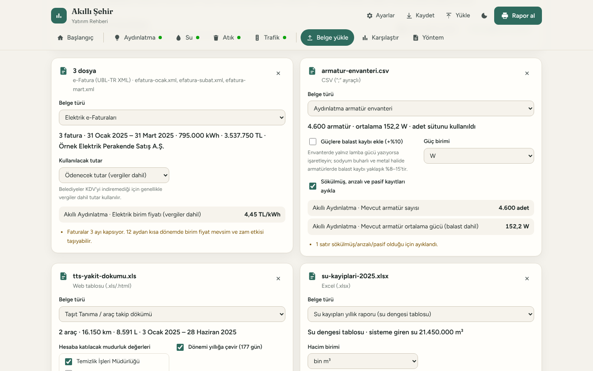 | 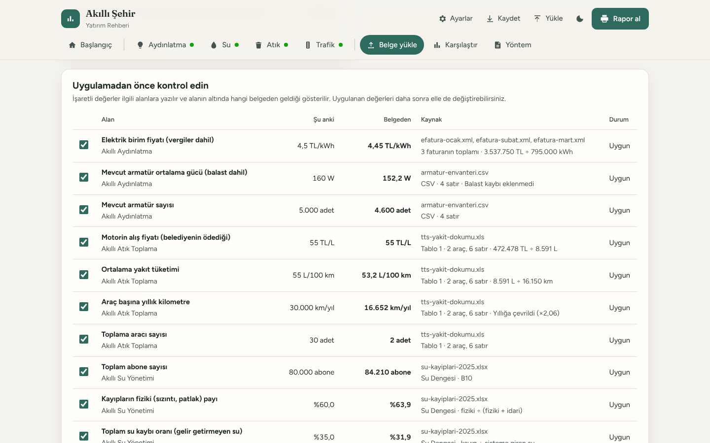 |

### Yan yana

| v1 – Klasik | v2 – Kontrol Merkezi | v3 – Sakin |
|---|---|---|
| 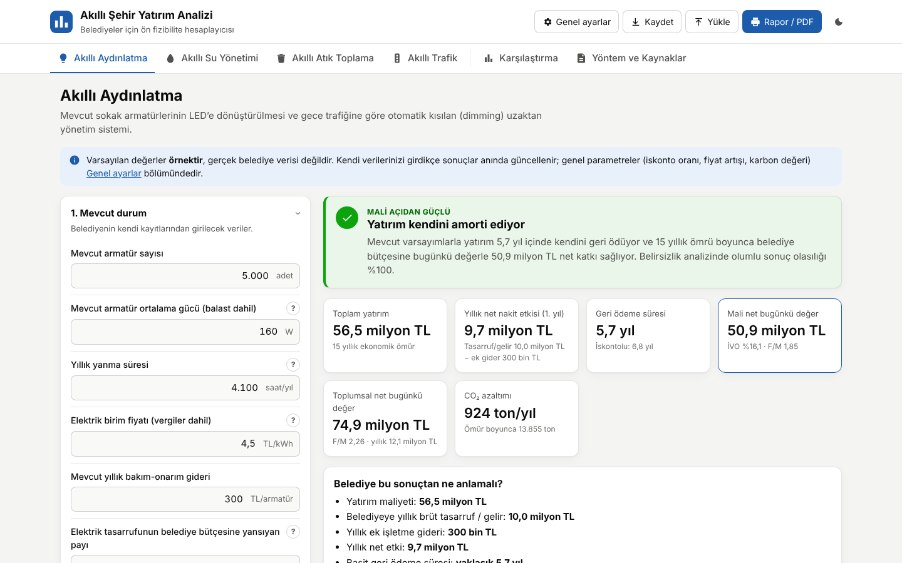 | 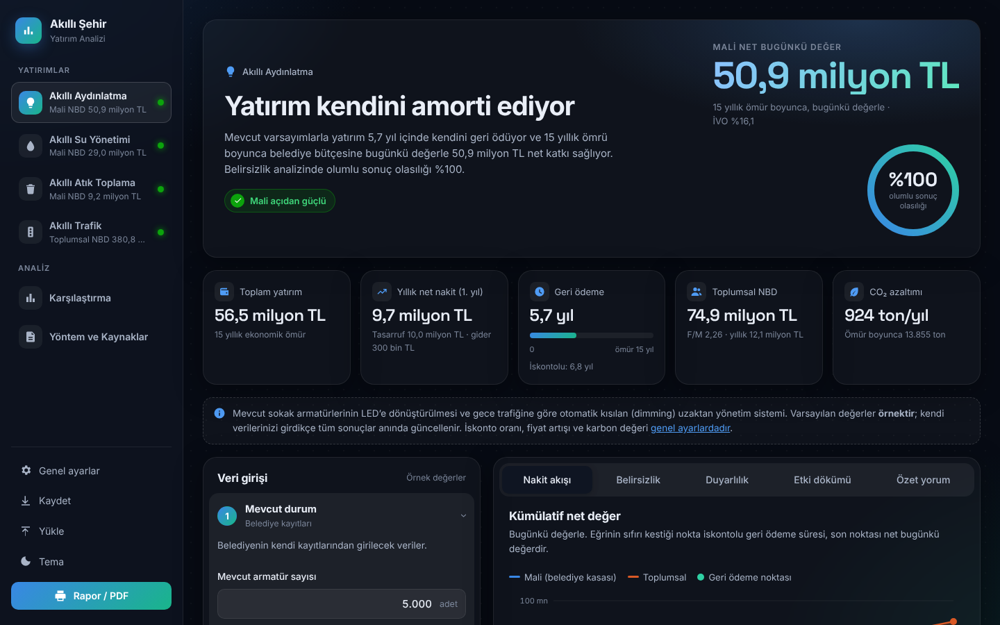 | 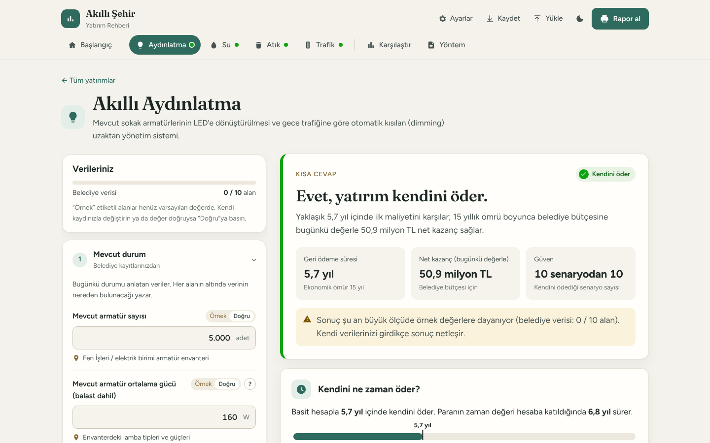 |
| 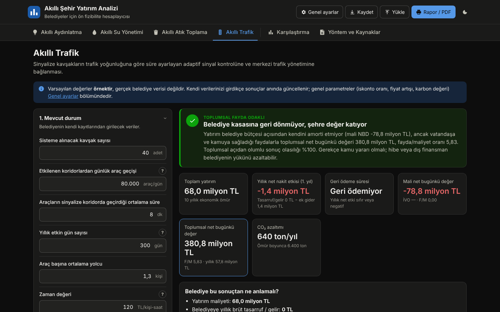 | 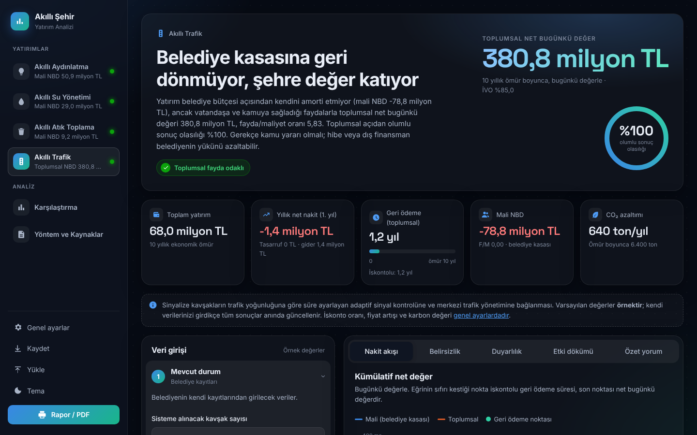 | 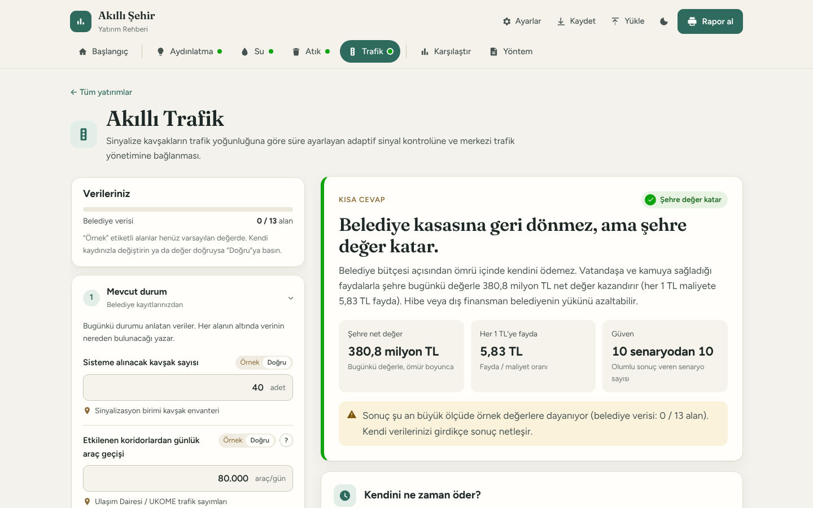 |
| 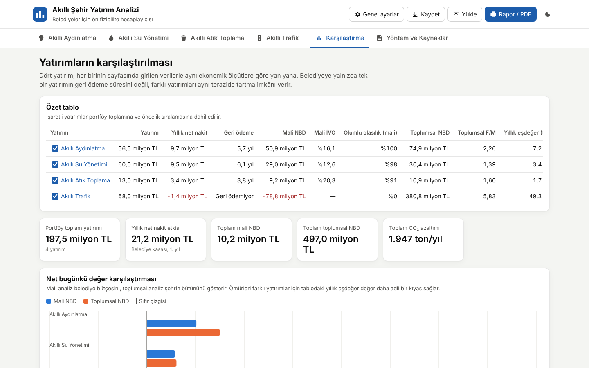 | 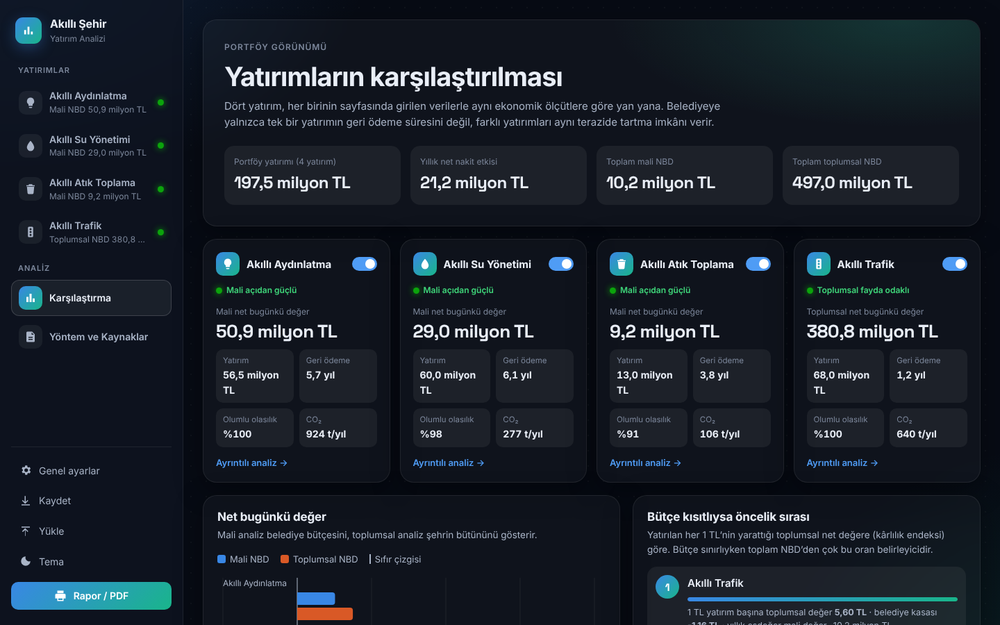 | 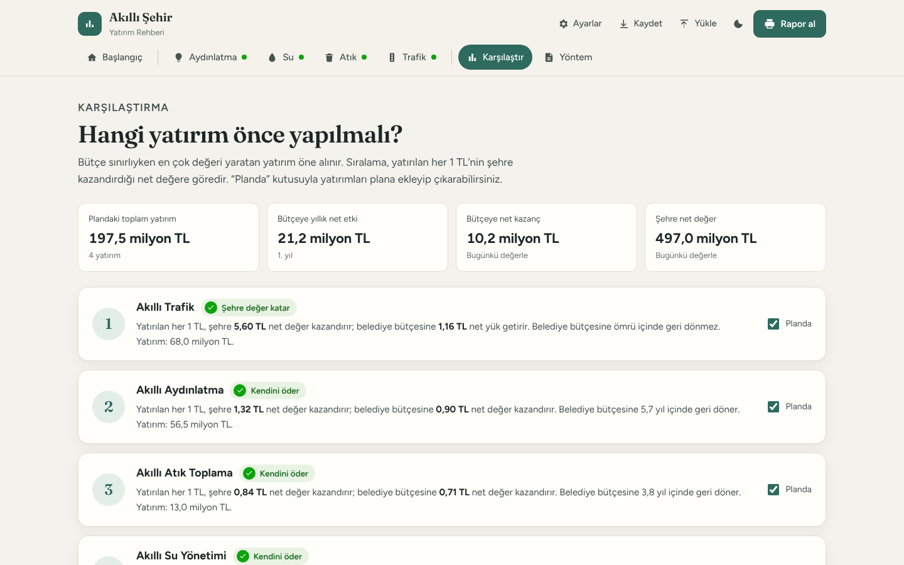 |
| 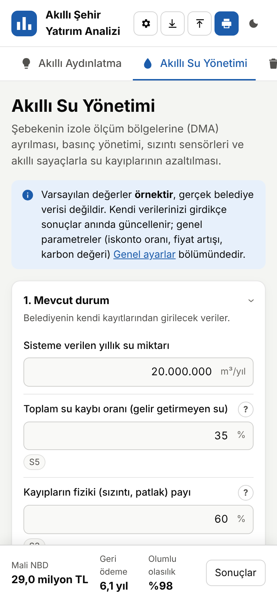 | 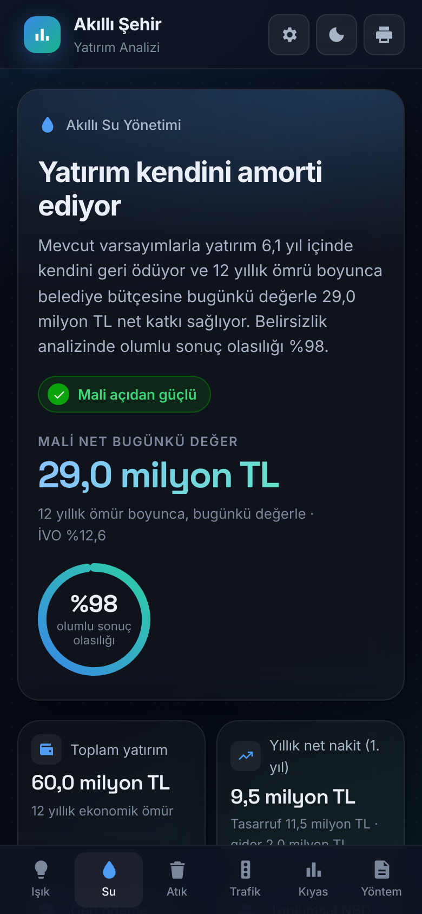 | 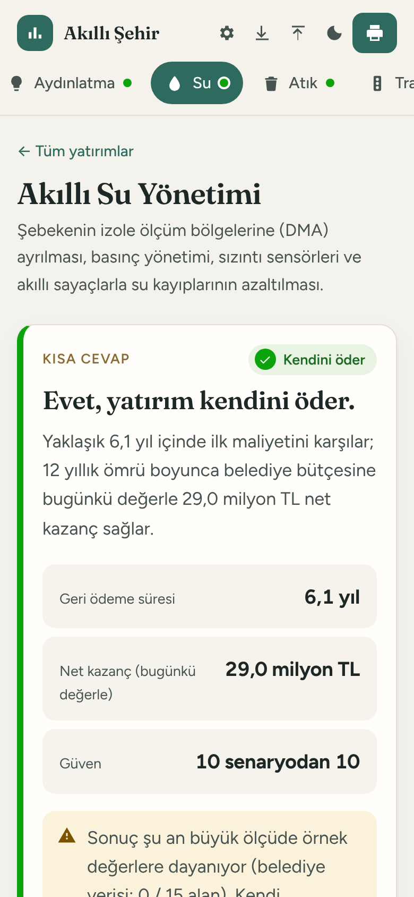 |

v3 başlangıç sayfası ve koyu tema:

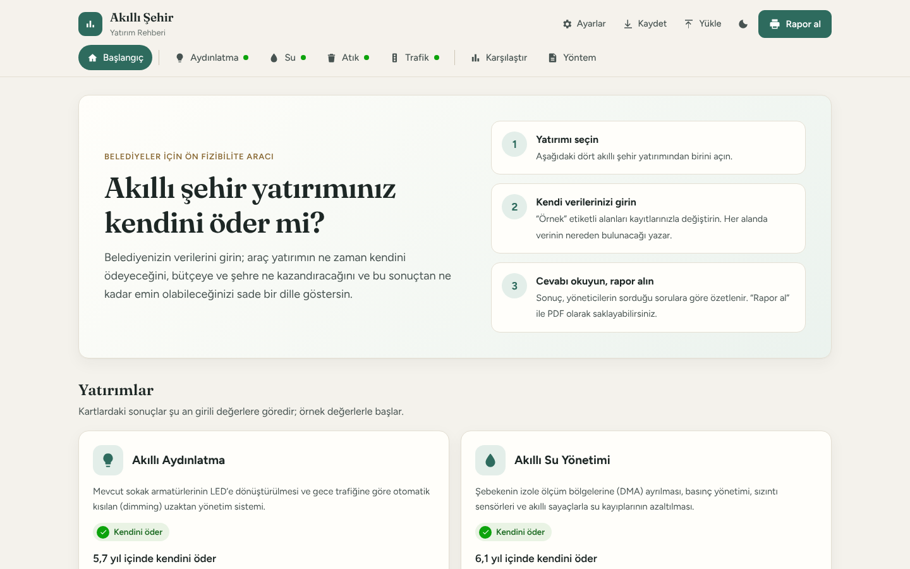

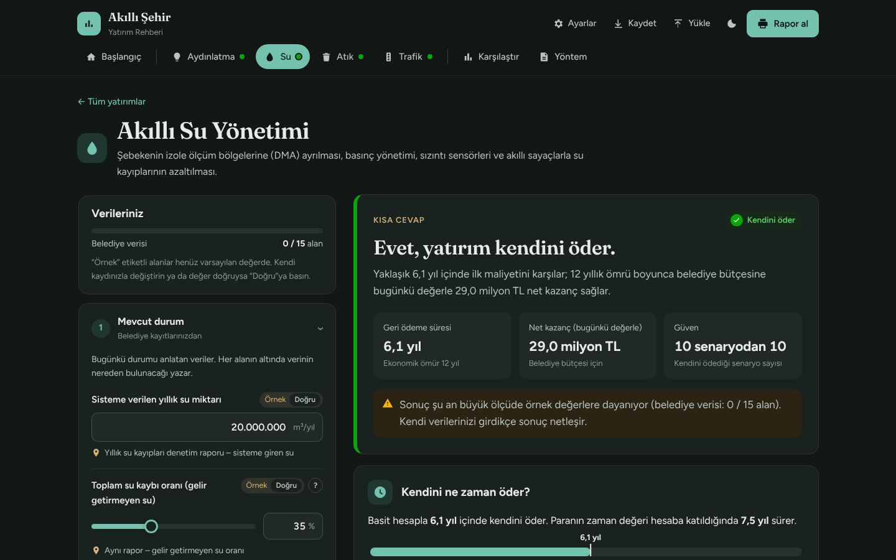

## Kapsanan yatırımlar

| Yatırım | Belediyeden istenen temel veri | Hesaplanan fayda |
|---|---|---|
| Akıllı aydınlatma | Armatür sayısı ve gücü, yanma süresi, elektrik fiyatı, bakım gideri | Enerji ve bakım tasarrufu, CO₂ |
| Akıllı su yönetimi | Sisteme verilen su, kayıp oranı, üretim maliyeti, tarife, arıza gideri | Önlenen fiziki kayıp, geri kazanılan gelir, onarım ve okuma tasarrufu |
| Akıllı atık toplama | Araç, km, yakıt, personel, konteyner verileri | Yakıt, bakım ve mesai tasarrufu, CO₂ |
| Akıllı trafik | Kavşak sayısı, araç geçişi, koridor süresi, zaman değeri | Vatandaşın zaman ve yakıt kazancı, CO₂ |

## Üretilen sonuçlar

- **Karar özeti:** sonucun sade dille yorumu (ör. “Yatırım kendini amorti ediyor”, “Belediye kasasına geri dönmüyor, şehre değer katıyor”).
- **Mali analiz (belediye kasası):** yıllık net nakit etkisi, basit ve iskontolu geri ödeme süresi, net bugünkü değer (NBD), iç verim oranı (İVO), fayda/maliyet oranı.
- **Toplumsal analiz:** vatandaşa ve kamuya giden faydalar ile CO₂ değeri dahil NBD (AB Maliyet-Fayda Analizi Rehberi yaklaşımı; hibe ve tarife gelirleri transfer sayılır).
- **Belirsizlik analizi:** 2.000 simülasyonluk Monte Carlo ile olumlu sonuç olasılığı ve P10/P50/P90 değerleri.
- **Duyarlılık ve başabaş:** sonucu en çok etkileyen varsayım, yatırımın kendini karşılaması için gereken eşik değer, tolere edilebilecek maliyet aşımı.
- **Karşılaştırma:** dört yatırım aynı ölçütlerle; portföy toplamı ve bütçe kısıtlıysa öncelik sıralaması.
- **Rapor / PDF:** tarayıcının yazdırma penceresiyle belediye adı ve tarih içeren rapor.
- **Kaydet / Yükle:** tüm girdiler JSON dosyası olarak saklanıp başka bilgisayarda açılabilir. Girdiler tarayıcıda da otomatik saklanır; hiçbir sunucuya gönderilmez.

Formüller, varsayımların dayanakları, kaynakça ve sınırlamalar uygulamadaki **Yöntem ve Kaynaklar** sekmesindedir.

## Teknik yapı

Sunucu tarafı kod, veritabanı veya derleme adımı yoktur; saf HTML/CSS/JavaScript (ES modülleri) ile yazılmış statik bir sitedir. Bu yüzden herhangi bir web barındırma hizmetinde çalışır. v2 (Inter, Space Grotesk) ve v3 (Figtree, Fraunces) tasarımları yazı tipleri için Google Fonts kullanır; internet bağlantısı yoksa sistem yazı tipine düşer.

```
index.html             Sayfa iskeleti ve Yöntem/Kaynaklar metni
assets/css/style.css   Stil (açık/koyu tema, mobil, yazdırma)
assets/js/models.js    Dört yatırımın girdileri ve hesap denklemleri
assets/js/engine.js    NBD, İVO, geri ödeme, Monte Carlo, duyarlılık, başabaş
assets/js/sources.js   Kaynakça
assets/js/charts.js    Bağımlılıksız SVG grafikler
assets/js/app.js       Arayüz
assets/js/hints.js     "Bu veri nereden bulunur?" ipuçları (v3)
assets/js/sheets.js    Belge okuyucu: xlsx, ods, csv, HTML/2003 XML tabanlı xls, e-Fatura XML (v3)
assets/js/xml.js       Bağımlılıksız XML ayrıştırıcı (v3)
assets/js/importer.js  Belge türlerini tanıma ve değer çıkarma (v3)
assets/js/template.js  İndirilebilir .xlsx veri şablonu (v3)
tests/                 Hesap motoru testleri (node --test)
```

Yeni bir yatırım türü eklemek için `models.js` içindeki `MODELS` dizisine aynı yapıda bir nesne eklemek yeterlidir; form, sonuçlar, belirsizlik analizi ve karşılaştırma otomatik olarak oluşur.

### Yerelde çalıştırma

```bash
npm start      # http://localhost:8080 (Python ile basit sunucu)
npm test       # hesap motoru testleri (Node.js 18+)
```

`index.html` dosyası doğrudan çift tıklanarak açılamaz (tarayıcılar `file://` üzerinden ES modüllerini engeller); bir web sunucusu üzerinden açılmalıdır.

## Kendi alan adınızda yayınlama

### Seçenek A – GitHub Pages (ücretsiz, önerilen)

1. Değişiklikleri `main` dalına birleştirin. `.github/workflows/pages.yml` her `main` güncellemesinde testleri çalıştırır ve siteyi yayınlar.
2. GitHub’da depo **Settings → Pages → Build and deployment → Source** alanını **GitHub Actions** yapın. (Özel/private depolarda Pages için ücretli GitHub planı gerekir; ücretsiz planda depoyu herkese açık yapmanız gerekir.)
3. Aynı sayfada **Custom domain** alanına alan adınızı yazın (ör. `akillisehir.com.tr`) ve **Enforce HTTPS** kutusunu işaretleyin.
4. Alan adını aldığınız firmanın DNS panelinde:
   - Kök alan adı (`akillisehir.com.tr`) için dört **A** kaydı: `185.199.108.153`, `185.199.109.153`, `185.199.110.153`, `185.199.111.153`
   - `www` için **CNAME** kaydı: `lecaytr.github.io`
5. DNS yayılımı genellikle birkaç dakika ile birkaç saat sürer; ardından site alan adınızda HTTPS ile açılır.

### Seçenek B – Mevcut bir hosting (cPanel, Plesk vb.)

`index.html`, `.nojekyll` (isteğe bağlı) ve `assets/` klasörünü FTP veya dosya yöneticisiyle sitenin kök dizinine (genellikle `public_html`) yükleyin. Başka bir ayar gerekmez.

### Seçenek C – Netlify / Cloudflare Pages

Depoyu bağlayın; derleme komutunu boş bırakın, yayın dizini olarak depo kökünü (`/`) seçin ve alan adınızı panelden ekleyin.

## Önemli not

Varsayılan değerler **örnektir**, gerçek belediye verisi değildir. Literatürden alınan etki oranları farklı ülke ve şehirlerden derlenmiştir; yatırım kararı öncesinde pilot uygulama ölçümleri ve ayrıntılı fizibilite etüdü ile doğrulanmalıdır. Kaynaklar makale veya resmî raporda kullanılmadan önce güncel baskıları ve sayfa numaralarıyla teyit edilmelidir.
